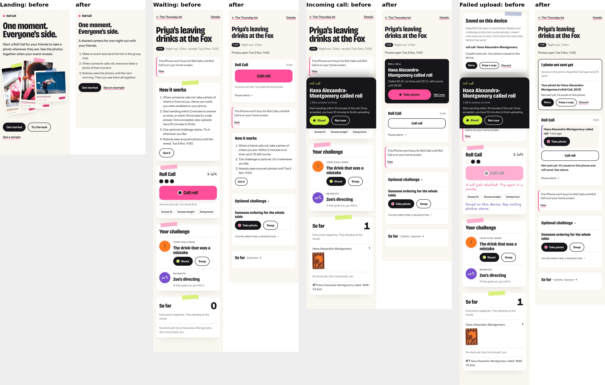
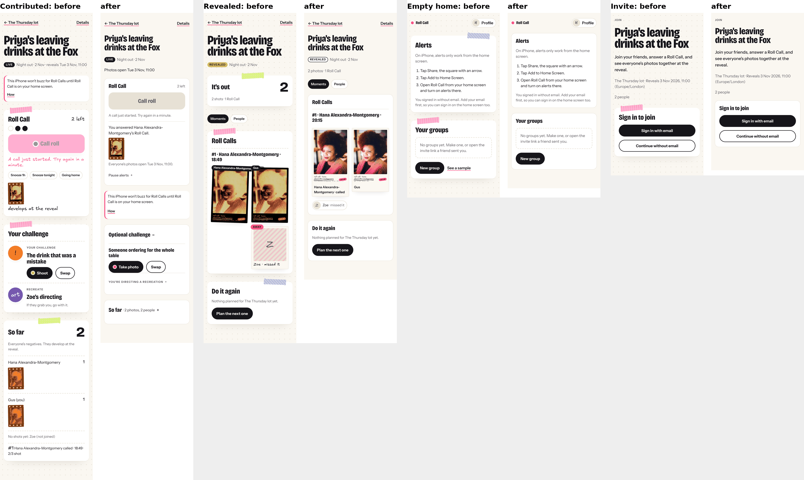
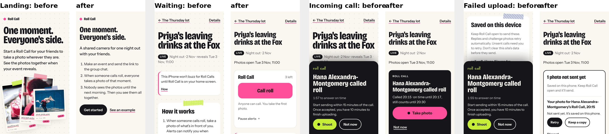

# Simplifying Roll Call (2 November 2026)

Branch `claude/simplify-roll-call`, from `codex/simpler-calls` at 383d6c4 plus the earlier review fixes (1aaa25c). Frontend only: no migration, RPC or rule changes, nothing deployed, nothing applied to hosted Supabase.

The owner's brief: the images feel arbitrary and plastered everywhere, the app should be much simpler, and it should be fun, easy and worth coming back to. This is the result of four desk reviews run in parallel (social product, behaviour, mobile design, implementation), collated here. Their full reports are in `research/`. None of this is user research. The personas below are simulated, and every claim about how people will feel is a hypothesis to test.

## Evidence and its limits

Labels used throughout: **[P]** primary source read directly, **[T]** third-party or secondary, **[R]** a claim already in this repo, **[C]** observed in code or screenshots, **[H]** hypothesis.

What was verified (all accessed 2 November 2026; URLs in `research/competitors.md` and `research/behaviour.md`):

- BeReal [P, App Store id1459645446 and bereal.com]: one notification a day at a random time, a shared two-minute window, late posts allowed and labelled, front and back cameras together, private feed, ads. You post before you see friends' posts [T, AAP]. Daily users fell 61% from about 15M to under 6M between October 2022 and March 2023 [T, Platformer citing NYT and Apptopia]; BeReal disputed this. In June 2026 it lifted the one-post limit and sent pings at World Cup match moments [T, CB News], which is close to Roll Call's idea of event-triggered calls.
- POV [P, App Store id1636032890]: host sets shots per guest and a reveal time, guests join by QR or link with no install (App Clip, web on Android), host curates, photobook. The brief's App Store id is POV's, not BeReal's.
- Lense [P, lense.app]: set up in under two minutes, join by QR or link with just a name, optional shot limit, instant or delayed reveal, offline capture, free up to 7 guests.
- The ordinary alternative [P]: phone camera plus a group chat and a shared album. Google Photos albums open by link without the app; Apple's support pages describe link joining from non-Apple devices in iOS 27. WhatsApp compresses by default.

What couldn't be read: help.bereal.com returned 403 to every fetch, so help-centre details come from search snippets only. App Store screenshot captions didn't render. Lense's App Store id wasn't found. POV's pricing page wasn't read.

`docs/research.md` was rechecked [R]. Three claims were corrected on this branch: the Airship link was dead (now cites the 2017 press release, and says the comparison group got zero pushes), the BeReal figure is 61% rather than "50 to 60%", and the anticipation study is two-sided and never tested countdowns. The NN/g tutorial figures, NN/g empty-state guidance, WebKit web-push requirements and the peak-end meta-analysis checked out.

Nothing in the app records answer rates, reveal opens or repeat events today, so no retention or participation figures exist for Roll Call.

## The use case

Job: get your friends' angles on an occasion, then enjoy them together.

**First audience [H]: one existing friend group of about 5 to 12, aged roughly 20 to 35, already in a group chat, with one motivated organiser, for a party or night out that reveals the next morning.** Birthdays fit inside that. Weddings are where POV and Lense already win (the host pays, QR codes on tables). Long trips are complex and Lense targets them. Remote friendships are BeReal's daily job.

Answers to the brief's questions, all [H] unless marked:

- **Why not the group chat?** The chat already works and costs nothing. Roll Call only wins if a friend's call gets the quiet people to shoot, if the next-morning reveal feels like a second small event, and if the album stays small and grouped by moment. Each photo has to cost less effort than posting to the chat.
- **What does simultaneous capture add?** One moment from several angles, and the usual photographer ends up in someone else's frame. It's the one thing nobody else does. Nobody has shown people value it, so the study compares how often Roll Call photos are kept or shared against self-paced challenge photos.
- **Repetitive photos when everyone's together?** Likely in one small room. Better when people are at the same occasion but spread out (rooms, bar and smoking area, a festival). The reveal groups each call into one grid, which turns repetition into "the same moment, five ways".
- **Better when dispersed?** Partly. Spread across one venue, yes. In different cities it becomes BeReal.
- **Half participation?** Probably still worth it with three or four angles per moment; two is thin. What hurts is a grid half full of "missed it" cards, so missing people are now small.
- **Optional prompts vs calls?** Prompts interrupt less and suit the quiet guest. Calls are the differentiator. Keep calls as the core, with one optional challenge each, and test both.
- **Fun and repeat use** stay hypotheses. Repeat use is measured as the group starting another event at the next suitable occasion, not as daily opens.

Differentiation: POV and Lense are host-run disposable cameras whose shots are scattered through the night. In Roll Call any friend calls a moment, everyone shoots it, and the reveal is organised by those moments, for a group that persists between occasions.

## What the specialists said, and where they disagreed

Agreement: the landing collage was the main source of "arbitrary images"; real photos and the Recreate paintings are content and stay; the event page was doing five jobs at once; an incoming call should come first and should not cover the page; unsent photos sat above the page title; the reveal let missing people take photo-sized slots.

Disagreements and how they were settled:

| Question | Positions | Decision |
|---|---|---|
| Keep Recreate and the trip mechanics? | Social researcher: park decks, hunts, wildcards and Recreate for v1. Brief: challenges are the hook. | Kept, but folded. Challenges get one compact card; the director's painting is one tap in. Removing them is a product call for the owner. |
| Away cards in the reveal | Behaviour: summarise misses, make away cards opt-in. Brief rule 5: a missed call shows the person's away card. | Kept the away card, shrunk to a chip under the photos with its reason. Opt-in needs the owner. |
| How much identity to strip | Designer: tape, tilt and handwriting may be what makes it warm; test with the owner. Others: they're the clutter. | Removed tape, tilt and dots; kept the print treatment, the film negatives, one pink accent and the display type. If it reads as generic, the print is where to add warmth back. |
| Try the look on upcoming events | Implementer: the brief asks for it. Owner feedback: stop pushing the demo. | Removed from the journey; reachable from the example page only. |
| Host extras | Behaviour: cap them, lengthen the one-minute guard. | Backend rule, out of scope for a visual pass. Listed under backend dependencies. |
| Simultaneous calls vs prompts | Social and behaviour: unproven. | Unchanged in code; it's the first thing the study tests. |

## Image policy

- **Stays:** the group's own photos as prints (reveal, lightbox), your own negatives before the reveal, everyone's tiny negatives in "So far", the Recreate paintings for the director and side by side in the reveal, away-card selfies as small chips.
- **Goes:** the stock-photo hero collage (deleted, with its CSS), tilted and taped images, coloured mission icons, the "See a sample" link on signed-in home, Try the look on upcoming events.
- **The demo:** one labelled "See an example" link on the signed-out landing page goes to `/sample`, which now says it's an example with Unsplash photos and made-up names. Try the look is linked from there.
- **Empty states:** text plus one action, no images, no invented people. Signed-in home with no groups: one line and New group.
- **Enforced by tests:** `tests/images.test.mjs` fails if anything outside `lib/sample.ts` references the sample photos, if the signed-in journey links to `/sample` or `/try`, or if the collage, tape or tilt CSS returns. `tests/dev-stack/states.mjs` records network requests per screen: 0 stock images on landing, sign-in, welcome, empty home, group, invite, alerts and every event state; 27 on the example page.

## Visual hierarchy, before and after

Page heights in CSS pixels at 390px wide, before and after (from `test-results/states-*/report.json`): landing 810 to 664 (no scroll on an iPhone 13), host event 2219 to 1645, guest event waiting 1914 to 1526, incoming call 1674 to 1406, failed upload 2099 to 1648, contributed 1968 to 1390, reveal 1392 to 1124. Heights vary a little run to run because challenges and Recreate are seeded per event. The 320x568 first screen of the incoming-call state now shows the event, who called, the times and Take photo (its bottom edge sits well inside the 568px screen).

Visual changes: plain paper (no dots), cards with a hairline border instead of tape and shadow, no rotation anywhere, h1 down from up to 86px to up to 54px, h2 from 30px to 24px. Handwriting stays on prints only, never on status or errors. One accent, pink: lime is gone from buttons, the alert and the Revealed pill; blue is only the focus ring; orange is only the "late" pill. Touch targets are at least 44px for buttons and links, 40px for chips. Top safe-area padding added.

## The state map

The event page puts one thing first depending on state. Each slot stays mounted, so a refresh can't drop a photo mid-capture.

| State | First thing | Primary action | What folds or recedes |
|---|---|---|---|
| Invite | Event name, group, when photos open | Join event | Unchanged (it was already close) |
| Waiting, live | Roll Call card | Call roll | How it works (3 lines, dismissible), challenge card, "So far" folded to one line, Pause alerts folded |
| Incoming call | A dark card under the title: "Hana called roll", "Called 20:08 · on time until 20:10, still counts until 20:23" | Take photo | Call roll becomes an outline button; its hint is hidden. "Not now" moves the call into the Roll Call card and holds across reloads. Several open calls each get a card. |
| Sending or failed | "1 photo not sent yet" under the title, then each photo described ("Your photo for Hana's Roll Call, 20:08") | Retry | Keep a copy and Discard (with confirm) beside it. On other pages, a folded "1 photo from another event not sent yet" line, so recovery works even if the event is gone. |
| Contributed | In the Roll Call card: "You answered Hana's Roll Call", your negatives, "Everyone's photos open Tue 3 Nov, 11:00" | None needed | No progress bars, no "No shots yet: names" list, no "1/3 shot" tallies |
| Revealed | "2 photos · 1 Roll Call", then each call's photos in a straight grid, name under each print | Tap a print to open it | People who missed it as small chips with the reason. The lightbox has Save, Close, and Delete/Report/Remove; Escape closes and focus returns to the print. |
| Challenges and Recreate | One card titled "Optional challenge" with the task, Take photo and Swap | Take photo | Trips fold the card. The director's painting is behind "You're directing a recreation"; everyone else sees one line. |

Copy, all short and plain: "Shoot" became "Take photo", "Printing…" became "Saving…", the 15/10-minute upload sentence is gone from the call, the call sheet says "Alerts go to 3 people, if their phones allow it.", the start push says "Roll Calls are open from now." instead of "Your challenge is ready."

## Simulated personas (not real users)

Seven invented people at familiarity levels 0 to 10, walked through invite, join, contribute, a failure, returning for the reveal, keeping a photo and leaving, on this branch. They only illustrate risks for the study to test.

| Level | Persona | Where they hesitate or get stuck | Host help? | Abandon risk |
|---|---|---|---|---|
| 0 | Reluctant guest, Android, joined because a friend insisted | The invite asks for email or "Continue without email"; they don't know which. Ignores the challenge. If no alert arrives, they never answer a call. | Likely, at sign-in | High before the first photo. Low once in. |
| 2 | Casual iPhone user, Safari tab | The alerts step says to add the app to the Home Screen; they skip it. They see calls only when they open the app. A failed upload says "Not sent yet" with Retry, which they understand. | Possibly, for alerts | Medium: misses calls, still sees the reveal |
| 4 | Social guest, there for the people | Calls feel fun at first. A fourth host extra in an hour would feel like nagging; the snooze is now one tap further in, under Pause alerts. | No | Low, but mutes if calls pile up |
| 5 | Occasional host | Has to make a group before an event, and the event needs two people from the group, so they can't set it up alone and invite later. Finds Send event invite in Details. | They are the help | Medium at setup |
| 7 | Photo-conscious participant | Wants to see their shot. The negative-only preview frustrates them; the reveal's straight grid and Save work. May delete a shot they dislike (possible before the reveal from the challenge card; Roll Call answers can't be deleted until the reveal). | No | Low |
| 9 | Frequent organiser | Wants several open calls handled cleanly (they now get a card each) and the reveal to end on "Plan the next one" (it does). Misses the old big counts. | No | Low |
| 10 | Power user | Uses Just us N, snooze, swaps, Recreate. Will hit the one-minute guard and wonder why the message says "Try again in a minute" while a call is waiting (now hidden in that case). Asks for a cap on host extras. | No | Low |

Patterns across them [H]: entry (sign-in and iPhone alerts) is where people most likely need help, as in the competitor comparison; once someone has taken one photo they tend to stay; calls are the main source of possible annoyance; the reveal works even for people who missed calls.

## What changed

- `src/app/page.tsx`: landing without the collage; three plain steps; Get started plus "See an example". Signed-in home drops the sample link. `src/components/hero-collage.tsx` deleted.
- `src/app/sample/*`: labelled Example, says the photos are Unsplash and the names made up, links Try the look.
- `src/app/globals.css`: the visual changes above; tape, collage, rc-dot and mission-icon styles removed; inline call card, pending list, folded sections, small away chips, print captions.
- `src/app/events/[id]/page.tsx`: state-led order; unsent photos under the title; challenge card; "So far" folded without tallies or the "no shots yet" list; no Try the look.
- `roll-call.tsx`: incoming calls as inline cards above the Roll Call card, one per open call; "Not now" stored per call in sessionStorage; clock times instead of a seconds countdown; contributed confirmation with the reveal time; Pause alerts folded; plainer copy.
- `missions.tsx`, `recreate.tsx`, `how-it-works.tsx`: no coloured icons or duplicate labels; Take photo; Recreate folded for the director; How it works in three lines.
- `reveal.tsx`, `away-card.tsx`: away cards as small chips; captions under prints; no tilt; lightbox gets aria-modal and focus return.
- `pending-photos.tsx`, `photo-recovery.tsx`: per-event inline panel on event pages, folded line elsewhere (the global one excludes the open event, so there's one retry loop per photo); photos described in words.
- `src/app/api/push/reveals/route.ts`: neutral start-of-day push.
- `docs/research.md`: three corrections above.

Every protection from the brief is unchanged: the on-device queue saves before any processing; photo ids are stable and retries are duplicate-safe; calls never retry on their own; the sign-in `next` destination; transactional invite joining; server-enforced budget, guard, host extras and deadlines; sealed photos via RLS and signed URLs (your own pre-reveal shots still render as negatives); delete, report and moderation; no migration edits.

## Deferred, and why

- **Recreate director who hasn't joined** ("Zoe's directing" while Zoe hasn't joined). The director is computed the same way on every device from event id, day and person; changing who can be picked changes everyone's missions. Needs a deliberate change to `lib/missions.ts`.
- **An answer that's waiting to send still shows its call as open.** The card says "Hana called roll · Take photo" next to the unsent panel, so someone might take a second photo. Marking the call as "sending" from the device queue is a small follow-up.
- **The offline note with an expired sign-in token** stays on "Saved on this phone. Sending…" until the connection returns. The photo is safe and sends; the message should change to "Not sent yet" sooner.
- **Recovered from the earlier review, still open:** no offline app shell, the orphan-sweep race, API timing. See `docs/simpler-calls-review.md`.
- **Group page and trips** were only cleaned visually, not restructured.

## Backend and product dependencies

These need separate, scoped work, and none were changed here:

- An event-first, invite-later flow: `create_event` needs a group and at least two members from it. Simulating it with placeholder people was ruled out.
- A cap on host extras and a longer guard than one minute (behaviour review).
- Event-only guests, host-only draft events, configurable reveals, reactions, unrestricted posting.
- Guests shooting before signing up (POV and Lense do this; it's the biggest entry gain available).
- Event logging for the study below. Nothing is recorded today.

## Tests

All run against this branch on 2 November 2026, with a production build and a local Supabase stack (Docker):

- `npm test`: 13 pass (10 existing plus 3 image-policy tests).
- `npm run test:browser`: both browser suites pass (photo recovery; invitations).
- `npm run typecheck`, `npm run lint`, `npm run build`: clean.
- `npm run test:dev-stack`: api, email, offline, expired, journey and the new `states.mjs` all pass. `states.mjs` checks, among other things: the incoming call is right after the title and before Call roll; Take photo is the first button in reading order and on the first 320x568 screen; "Not now" survives a reload; the unsent panel sits under the title with Retry and Keep a copy and appears once; other pages show the folded line; the contributed state has no tallies or "no shots yet" list; the reveal shows the missing person as a chip; lightbox focus in, Escape out, focus back; prints show developed straight away with reduced motion; axe (WCAG 2 A/AA) is clean in light and dark on landing, invite, waiting, incoming call, failed upload, contributed and reveal; no sideways scroll at 320px or at 200% zoom.
- Updated assertions: the journey test expects the new wording and dismisses each open call card; nothing was replaced with snapshots.

Not checked: real iPhones and Android phones, VoiceOver and TalkBack, actual push delivery, the develop animation on a slow phone, and the flash grade on real faces.

## Study plan

A small field study with real friend groups, before more design work. The full metric table with numerators, denominators and notes is in `research/behaviour.md`, section 4.

Setup: four to six existing friend groups of 5 to 12, each with both iPhone and Android, each running one real night out. The organiser invites everyone through their usual messaging app; the researcher doesn't install anything for them. Expect, and record rather than prevent: declined notifications, iPhones in a Safari tab, slow or flaky connections, missed calls, people leaving early. Before the study, add event logging (invite opened, joined, alert permission shown, granted or denied, call sent, push sent or failed, answered on time or late, Not now, snooze or home, saved on phone, upload retried or succeeded, reveal opened, photo saved or shared, next event created), a three-question post-event survey and a short interview.

Measures, each reported as a count over its denominator, per group and per platform (iPhone installed, iPhone in Safari, Android):

- Unassisted joining: reached the event signed in without asking anyone / opened the invite.
- First contribution: at least one accepted photo / joined. Plus time and taps from opening the invite to that photo / those who contributed.
- Host help: requests to the host, coded by reason / invitees.
- Events with at least 2 distinct contributors / events run; calls with at least 2 photos / calls made.
- Answers on time and late / recipients, split by alert delivered, not subscribed, snoozed or home.
- Recovered without retaking: photos whose first upload failed and later sent from the phone copy / photos whose first upload failed. Count discarded and stranded copies too.
- Interruptions: calls rated "came at a bad moment" / calls received. Pressure: agree with "I felt I had to answer" and "I felt bad when I missed one", asked separately for calls, challenges and the reveal / respondents. Opt-outs: snooze, home, alerts revoked, left the event / joined.
- Return to the reveal within 48 hours / people on the event, split by contributors and non-contributors. Saved or shared, with reasons / people who opened the reveal.
- Simultaneity: keep or share rate for Roll Call photos vs challenge photos, within person.
- Voluntary participation at the next occasion: groups where a member, not the researcher, starts or joins another event / groups that had a suitable occasion during a 4 to 6 week follow-up.

Limitations: small n, so report counts and reasons, not percentages of tiny groups; participants know they're in a study; friend groups recruited by the researcher skew towards people who like trying apps; one night per group says little about repeat use. No targets are set because there's no benchmark for this kind of product. Daily opens are not a measure. The study doesn't add streaks, scores, reminders between events or extra notifications to lift numbers.
